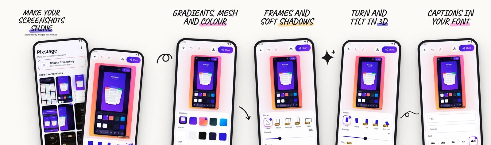
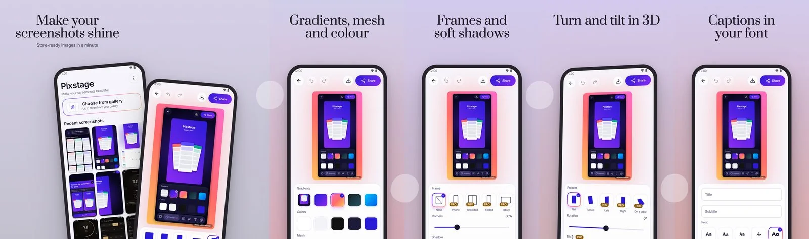
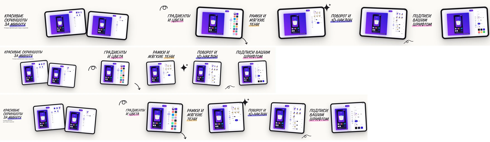

# agent-skills

My personal catalog of skills for AI coding agents.

Every skill is a folder with a `SKILL.md` file in the open [Agent Skills](https://agentskills.io) format, so the same files work in Claude Code, Codex, Cursor, Gemini CLI, OpenCode and other agents that read skills.

## Skills

### `android` plugin

| Skill | What it does | Needs |
|---|---|---|
| [writing-store-changelogs](plugins/android/skills/writing-store-changelogs/SKILL.md) | Writes "What's new" for one version into `fastlane/metadata/android/<locale>/changelogs/<versionCode>.txt`, within Google Play, F-Droid, RuStore and AppGallery limits | Python 3 |
| [publishing-bundle-to-play](plugins/android/skills/publishing-bundle-to-play/SKILL.md) | Publishes a built AAB to a Google Play track, with a dry run and confirmation | [gplay](https://github.com/tamtom/play-console-cli) |
| [publishing-screenshots-to-play](plugins/android/skills/publishing-screenshots-to-play/SKILL.md) | Uploads listing screenshots and the feature graphic from the fastlane tree to Google Play, with a preview and confirmation | [gplay](https://github.com/tamtom/play-console-cli) |
| [publishing-bundle-to-rustore](plugins/android/skills/publishing-bundle-to-rustore/SKILL.md) | Sends a built AAB update to RuStore moderation, with a dry run and confirmation | [rustore-publisher](https://github.com/vyachin/rustore-publisher) |

### `store-assets` plugin

| Skill | What it does | Needs |
|---|---|---|
| [making-store-screenshots](plugins/store-assets/skills/making-store-screenshots/SKILL.md) | Builds a styled 5–8 frame series of store screenshots (App Store, Google Play, RuStore, AppGallery, F-Droid) from an app's screenshots, checks it against store rules and places it into the fastlane tree | Python 3, Playwright, Pillow |

#### Example: making-store-screenshots

Six plain screenshots captured from an emulator, one request ("make Google Play screenshots in the sketch style"), and
this is what lands in `fastlane/metadata/android/<locale>/images/phoneScreenshots/`: a cover spread over two frames,
one feature per frame, doodles that continue across the borders.



The same screens in the `tone` style, where each frame takes its colour from its own screenshot:



Tablet (16:9) and foldable (1:1 and 4:3) sets are laid out for their own shapes, from tablet and foldable captures:



## Install

Skills are grouped into plugins by topic. Install a whole plugin, or single skills.

### Claude Code

```bash
claude plugin marketplace add LinDevHard/agent-skills
claude plugin install android@lindevhard-skills
claude plugin install store-assets@lindevhard-skills
```

Inside a session, the same works as `/plugin marketplace add LinDevHard/agent-skills` and `/plugin install android@lindevhard-skills`.

### Codex

```bash
codex plugin marketplace add LinDevHard/agent-skills
codex plugin add android@lindevhard-skills
codex plugin add store-assets@lindevhard-skills
```

### Any other agent

The [skills](https://github.com/vercel-labs/skills) CLI installs into Cursor, Gemini CLI, OpenCode, Windsurf and many more, and also into Claude Code and Codex:

```bash
npx skills add LinDevHard/agent-skills
```

It asks which skills and which agents. Add `-g` to install for your user instead of the current project, or `--skill <name>` to pick one skill.

### By hand

Copy or symlink a skill folder into your agent's skills directory, for example `~/.claude/skills/` (Claude Code) or `~/.agents/skills/` (Codex).

## Update

| Installed with | Command |
|---|---|
| Claude Code | `claude plugin marketplace update lindevhard-skills`, then `claude plugin update android@lindevhard-skills` |
| Codex | `codex plugin marketplace upgrade lindevhard-skills`, then `codex plugin add android@lindevhard-skills` |
| skills CLI | `npx skills update` |

## Layout

```
agent-skills/
├── .claude-plugin/marketplace.json   # Claude Code marketplace
├── .agents/plugins/marketplace.json  # Codex marketplace
├── skills.sh.json                    # tells the skills CLI to look in plugins/
└── plugins/
    └── android/                      # one plugin per topic
        ├── plugin.json               # Agent Plugins manifest (Codex, ChatGPT)
        ├── .claude-plugin/plugin.json
        └── skills/
            └── <skill-name>/
                ├── SKILL.md
                ├── references/       # loaded only when SKILL.md links to them
                └── scripts/          # run, not read
```

## Adding a skill

1. Create `plugins/<plugin>/skills/<skill-name>/SKILL.md`. The folder name and the `name` field match: lowercase letters, digits and hyphens.
2. Start it with frontmatter that says what the skill does and when to use it:

   ```markdown
   ---
   name: skill-name
   description: What it does and when the agent should use it.
   ---
   ```

3. Add the skill to the table above and bump `version` in both of the plugin's manifests, so installed copies update.

A new topic is a new plugin: copy `plugins/android/` without its skills, rename it in both manifests, and add an entry to both marketplace files. Check the result with `claude plugin validate .`.

## License

[MIT](LICENSE)
